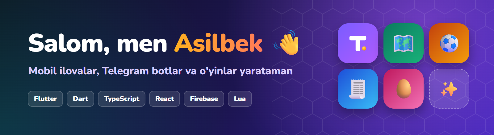
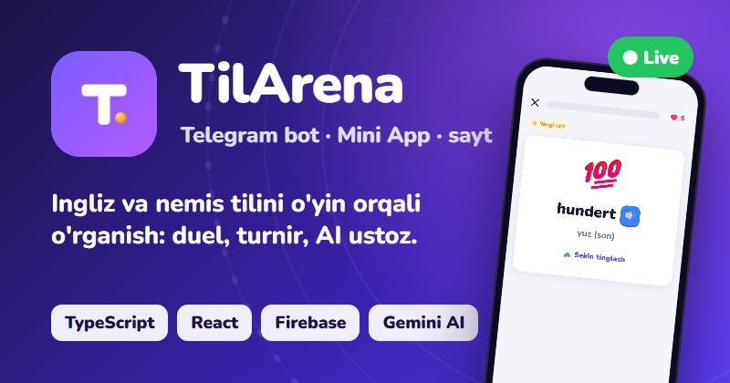
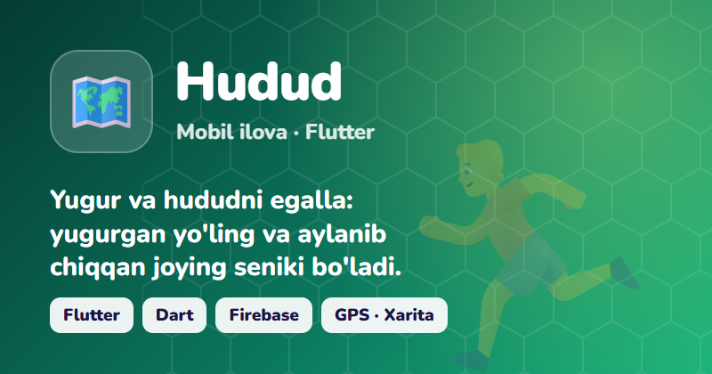
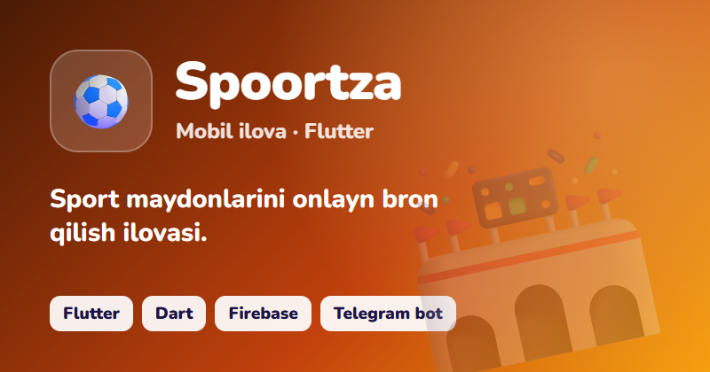
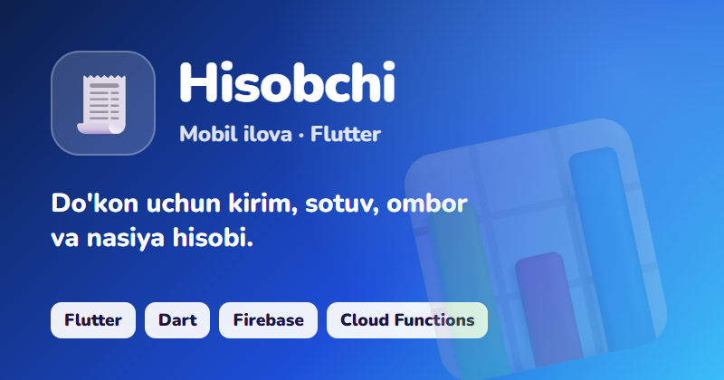
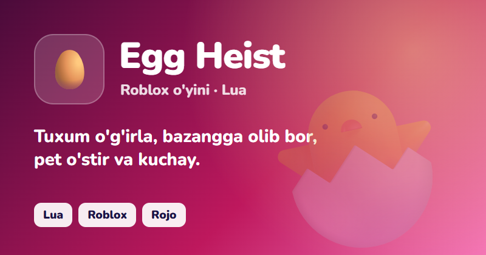
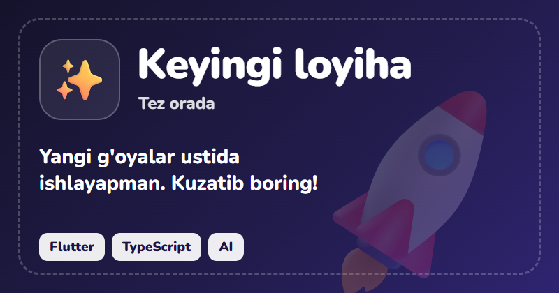

## 👋 Men haqimda

- 🚀 Hozir **[TilArena](https://t.me/tilarenabot)** ustida ishlayapman: ingliz va nemis tilini o'yin orqali o'rgatadigan Telegram bot va Mini App.
- 📱 **Flutter** bilan mobil ilovalar, ⚙️ **TypeScript** bilan Telegram botlar va serverlar, 🎮 **Roblox** o'yinlari yarataman.
- ☁️ Loyihalarimning ko'pi **Firebase** ustida: Auth, Firestore, Hosting, Cloud Functions.
- 💬 Ilovalarim o'zbek tilida, o'zbek foydalanuvchilari uchun.

## 🚀 Loyihalar

<table>
  <tr>
    <td width="50%"></td>
    <td width="50%"></td>
  </tr>
  <tr>
    <td></td>
    <td></td>
  </tr>
  <tr>
    <td></td>
    <td></td>
  </tr>
</table>

## 🛠 Texnologiyalar

| Yo'nalish | Nimalar bilan |
|---|---|
| 📱 Mobil | Flutter, Dart, MapLibre, Yandex MapKit, GPS, shtrix-kod skaneri |
| 🤖 Botlar va server | TypeScript, Node.js, grammY, Vercel Functions |
| 🌐 Web | React, Vite, Telegram Mini Apps |
| ☁️ Backend | Firebase (Auth, Firestore, Hosting, Cloud Functions) |
| ✨ AI | Gemini API: suhbat, matnni baholash, nutq sintezi |
| 🎮 O'yinlar | Roblox, Lua, Rojo |

